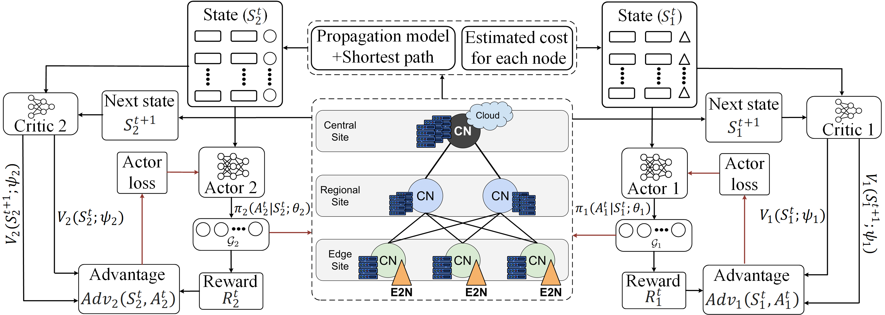
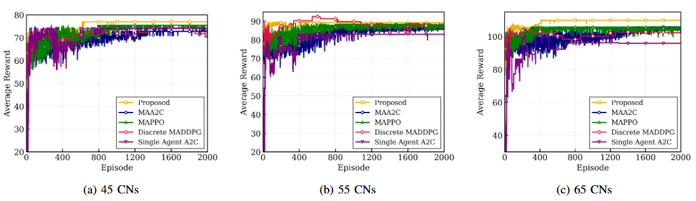

# Two-Stage Hierarchical Multi-Agent Advantage Actor-Critic (A2C) (TSH-MAA2C) Framework for Optimizing Near-RT RIC Components Placement Across O-Cloud

## Overview

This repository contains the implementation of the **Two-Stage Hierarchical Multi-Agent Advantage Actor-Critic (TSH-MAA2C)** framework, a Deep Reinforcement Learning (DRL)-based solution developed to optimize the placement of Near-Real-Time RAN Intelligent Controller (Near-RT RIC) components across a heterogeneous three-tier O-Cloud infrastructure. The framework aims to minimize infrastructure deployment costs while satisfying stringent end-to-end latency and heterogeneous computing node (CN) capacity constraints. To reduce the complexity of large-scale placement decisions, the implementation decomposes Near-RT RIC components into two service groups and employs a hierarchical two-agent learning architecture. State-dependent latency-and-coverage feasibility masks and resource-feasibility masks are incorporated to eliminate infeasible placement actions, stabilize training, and improve policy learning.

## TSH-MAA2C Framework Architecture

The developed TSH-MAA2C framework implements a sequential decision-making process involving two cooperative A2C agents, as illustrated in the architecture below. **Agent 1** first determines the placement of the G1 service pair by solving its observable Markov Decision Process (MDP), accounting for global O-Cloud constraints, including inter-node communication latency, computing resource availability, and node deployment costs. Its placement decision updates the environment state by modifying resource availability and feasible placement choices for subsequent decisions. **Agent 2** then observes the updated system state, conditioned on Agent 1's placement decision, and determines the placement of the G2 service pair. This hierarchical coordination enables both agents to learn cost-efficient placement policies while enforcing a two-hop control-loop latency constraint of **10 ms (G2 → G1 → E2N)** and satisfying heterogeneous computing resource constraints.

## Experimental Evaluation and Performance Comparison

The implementation includes training and evaluation experiments across heterogeneous O-Cloud topologies comprising **45, 55, and 65 computing nodes (CNs)**. The proposed TSH-MAA2C framework is evaluated against Single-Agent A2C and representative multi-agent DRL baselines, including MAA2C, MAPPO, and Discrete MADDPG. The comparison figure below presents the episodic reward convergence across these network configurations, highlighting convergence stability and steady-state reward performance. The experimental results demonstrate that the hierarchical two-agent structure effectively decomposes the placement problem, supports stable policy learning, and maintains competitive placement performance as the O-Cloud topology scales.

